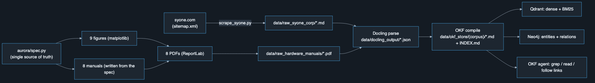

# Data, datasets and ingestion pipeline

Two knowledge bases feed the formation. They were chosen to stress **different** retrieval skills, and both are verifiable: every golden question has an answer you can find in the source files.

| | Corpus 1: **Syone website** (`syone_corp`) | Corpus 2: **Aurora AOR-3 manuals** (`hardware_manuals`) |
|---|---|---|
| Origin | **Real**: live crawl of <https://www.syone.com> | **Synthetic and fictional**: written for the formation |
| Format | 79 Markdown pages (+ `_manifest.json`) | 8 PDFs (7-10 pages each) with tables and embedded figures |
| Size | about 65k words | about 29k words, 30 fault codes, 9 figures |
| Teaches | Messy real-world text, FAQs, news, "what is Syone"; honest "I don't know" | Exact-match lookup (BM25), near-duplicate codes, tables, **figures that carry facts**, multi-hop relations |
| Images | 4 distinct informative images kept out of 215 scraped (see below) | 9 figures generated from the same spec as the text |
| Rebuild | `python scripts/scrape_syone.py` | `python scripts/download_hardware_manuals.py --rebuild` |

Both raw datasets are committed, so a fresh clone works **offline**. Re-running the scraper refreshes the Syone snapshot.



*Diagram source: `docs/diagrams/data_pipeline_and_sources_1.mmd` (Mermaid). Re-render with `npx @mermaid-js/mermaid-cli -i docs/diagrams/data_pipeline_and_sources_1.mmd -o docs/diagrams/data_pipeline_and_sources_1.png -c docs/diagrams/mermaid.json -b "#141B23" -s 2`.*

---

## 1. Syone: the real web crawl

### Why the first version was replaced
The original script did not really scrape. It contained four hard-coded "articles" and, for every URL, fetched the page and appended at most 1,500 characters to that text. Three of the four URLs it requested (`/partners`, `/solutions/ezsearch`, `/services/cloud-devops`) return 404, so in practice every run produced the built-in text. That text described an "ezSearch Active Green cluster / Standby Red cluster", an SLA of 99.99 %, an error code `ERR_EZSEARCH_FAILOVER_9901` and a host `proxy-green.syone.internal`: **none of it exists on syone.com**. The two "images" were diagrams drawn with Pillow. The formation therefore taught a RAG system about facts that the company never published.

### How the scraper works (`scripts/scrape_syone.py`)
1. Reads `https://www.syone.com/sitemap.xml` (372 URLs; `robots.txt` allows crawling). The site is server-rendered HubSpot, so plain HTTP is enough: no browser needed.
2. Selects pages with a **profile**: `core` (default) keeps every non-blog English page plus the 30 most recent blog articles; `full` keeps all English pages. The `/pt/` mirror, the event archive and index pages are skipped.
3. Converts each page body to clean Markdown: headings, paragraphs, lists, tables, and the **accordion FAQ blocks** (they become `### question` + answer under `## Frequently asked questions`). Navigation, footers, forms, cookie banners, "recent articles" widgets and testimonial chrome are removed.
4. Drops near-duplicate pages (the site publishes some pages under two URLs) and pages that are only an index.
5. Polite crawling: identifiable User-Agent, 0.6 s between requests.
6. **No silent fallback.** A page that cannot be fetched is listed as `failed` in `data/raw_syone_corp/_manifest.json`; if nothing works the script exits with an error.

Typical output of a run:

```
Sitemap: 372 URLs; profile 'core' selects 92 pages
[  1/92] ok     844 words  /how-we-do-it/turnkey-projects
...
Done: 79 pages kept (13 skipped as index/duplicate), 0 failed, 7 content images kept (28 sitewide images dropped)
```

| Section | Pages | Examples |
|---|---:|---|
| `what-we-do` | 8 | Observability & Data Monitoring, DevOps, Service Desk, Data/ML/AI |
| `how-we-do-it` | 4 | Nearshore, Managed Services, Turnkey Projects, Software Subscriptions |
| `partners` | 6 | Red Hat, Elastic, Zabbix, Microsoft Azure/365, GitLab, Syntevo |
| `technologies` | 9 | Java, Kotlin, Angular, React, Swift, Spring... |
| `news` | 14 | ISO renewals, the 29,500-device election monitoring project, meetups |
| `blog` | 29 | Zabbix vs Prometheus, Kibana, RHEL 9, VMware vs OpenShift... |
| `home`, `about`, `ezsearch-syone`, `careers`, `contact-us`, `social-responsibility`, `suse`, `camunda`, Azure landing page | 9 | company facts, offices, ezSearch, partner landing pages |

Each file starts with metadata the parser lifts into the knowledge base:

```markdown
# About Syone
Source: https://www.syone.com/about
Section: about
Summary: Founded in 1999 in Lisbon, Syone delivers open source IT solutions across 15 countries...
Scraped: 2026-10-19
```

### About the images (you were right to be suspicious)
Of 215 images found in the page bodies, almost all are **stock photography** (people at laptops, office interiors, city skylines, supermarket aisles) and blog banner cards. They carry no information, so a visual-grounding demo built on them would be theatre. The scraper therefore drops logos, badges and sitewide chrome automatically and then keeps only images from a **hand-reviewed allow-list** (`scripts/dataset_builder/syone_images_curated.json`). Four survive, and each has a written description of what it shows:

| Image | Page | Why it is useful |
|---|---|---|
| Footprint map (countries in green) | `about` | A fact that exists **only** in the picture: *where* Syone delivers |
| Elastic Stack layer diagram | `partners-elastic-official-partner` | Text inside a diagram (Kibana / Elasticsearch / Beats / Logstash) |
| Zabbix Meetup '26 poster | `news-syone-zabbix-online-meetup` | Speaker and talk title exist only as pixels |
| ezSearch promotional banner | `ezsearch-syone` | The three advertised benefits are written inside the image |

Use `--images heuristic` to keep every non-logo body image instead (about 170) or `--images none` for text only.

---

## 2. Aurora AOR-3: the synthetic hardware library

### Why synthetic
A formation needs questions with **known, checkable answers** and features real documents rarely have together: exact codes that look alike, tables, diagrams that hold facts, relations that span documents. Generating the corpus lets us control all of that, and keeps the demo independent of any real vendor.

> **Everything about Aurora Systems and the AOR-3 is fictional.** The design is inspired by public Open Compute Project Open Rack concepts (48 V busbar, power shelf, BMC with Redfish), but no value is a real specification. Never use it for real hardware. (The first version of the formation claimed to be OCP data and named a real Broadcom ASIC; that claim was removed.)

### How it is produced (`scripts/dataset_builder/aurora/`)
```
spec.py              single source of truth: components, 30 fault codes, LED states, thresholds, VLANs, firmware matrix
WRITER_BRIEF.md      the rules the writer model followed (facts only from spec.py, exact code strings, tables, figures)
src/*.md             8 chapters, 3.3k-4k words each, written by a small, cheap model (Claude Haiku) from the spec
render_figures.py    9 figures drawn with matplotlib from the same spec (+ figure_captions.json)
build_manuals.py     Markdown -> PDF with ReportLab (real tables, embedded figures) and validation against the spec
```
Because text and pictures come from one spec they cannot drift apart, and `build_manuals.py` fails if a code in the spec is missing from the manuals or the manuals contain a code that is not in the spec.

| Document | Content |
|---|---|
| `aor3_01_system_overview` | architecture, rack elevation (F1), power (F3) and network (F7) overview |
| `aor3_02_power_shelf_manual` | PS-3000, N+1 rectifiers, busbar, fuse F2, power faults, LED legend (F2) |
| `aor3_03_thermal_cooling_manual` | thresholds, fan curve (F5), fan wall hot-swap, DIMM layout (F8) |
| `aor3_04_network_switch_manual` | AS-100G port map (F4), `MGMT0` / `MGMT_VLAN_102`, VLAN plan, network faults |
| `aor3_05_bmc_redfish_guide` | `bmc-cli`, `bmc-reset --warm`, Redfish, BMC/security faults |
| `aor3_06_fault_code_reference` | **all 30 codes in one table**, near-duplicate pairs, flowchart (F6) |
| `aor3_07_maintenance_safety` | safety, torque, maintenance schedule (F9), escalation levels |
| `aor3_08_release_notes_firmware` | firmware compatibility matrix, upgrade order, known issues |

Deliberate difficulty built into the spec:

* **Near-duplicate codes**: `0x4A7B_VRM_OVERVOLT` vs `0x4A7C_VRM_UNDERVOLT`, `0x10E4_ECC_MULTI_BIT` vs `0x10E5_ECC_SINGLE_BIT`, `0x8F10_TEMP_WARN` vs `0x8F11_TEMP_CRIT`: embeddings blur them, exact matching does not.
* **A coarse LED**: ten codes share the *blinking amber* PWR LED. The legend says amber = thermal warning, but the fault table assigns it to many other faults. The right answer is "read the SEL code first" (figure F6 and the FAQ say so).
* **Figures that carry facts**: the rack elevation, port map, DIMM layout, fan curve and flowchart contain values that appear only partly in the prose.
* **Realistic noise**: the writers flagged several small ambiguities in the spec while writing (for example the solid-red LED for an AC-loss fault versus "LED off: no 48 V input"). They were left in on purpose: real manuals are not perfectly consistent.

### Can the images be AI-generated instead?
Photorealistic pictures cannot be produced natively here (no image-generation model is available inside this tool), and for this exercise they would be the wrong choice anyway: diagrams, legends, charts and flowcharts are exactly what technical manuals contain, and **drawing them from code makes them exact and checkable**. If you want photographic images later (a rack in a data hall, an LED close-up), generate them with ChatGPT/Gemini or a local model such as Qwen-Image, drop the PNGs into `data/extracted_images/hardware_manuals/`, add an entry to `figure_captions.json` and reference the file from a chapter.

---

## 3. From raw files to the knowledge base

| Stage | Command | Output |
|---|---|---|
| 1a Acquire (web) | `python scripts/scrape_syone.py` | `data/raw_syone_corp/` |
| 1b Acquire (manuals) | `python scripts/download_hardware_manuals.py` | verifies `data/raw_hardware_manuals/` |
| 2 Parse | `python -m backend.ingestion.run_docling` | `data/docling_output/*.json` |
| 3 Compile to OKF | `python -m backend.ingestion.run_okf` | `data/okf_store/{corpus}/*.md` + `INDEX.md` |
| validate | `python scripts/validate_dataset.py` | 30/30 codes intact, 34/34 golden questions answerable |
| 4 Index | `python -m backend.graph_rag.indexer` (or notebook 02) | Qdrant + Neo4j |

### Stage 2: Docling parsing (`backend/ingestion/docling_parser.py`)
* **`docling_standard`**: layout model + TableFormer + RapidOCR. About 35 s for all 87 documents on a laptop CPU.
* **Why not a vision model?** An earlier version also offered **GLM-OCR**, a 0.9B vision-language model (page image in, Markdown out), through Docling's VLM pipeline. Measured on the 8 manuals (Apple M4 Max): 569 s served on the GPU by LM Studio against 31 s for the standard pipeline, 368 table rows against 427, and the continuation of the fault table on its next page lost. It was removed; the classic pipeline wins on born-digital PDFs with tables.
* Native Markdown (the scraped pages) needs no OCR; the engine is reported as `native-markdown`.
* **Figures**: each figure is bound to its file through its caption line (`Figure F4: ...`) and its description is stored next to it. A language model never sees pixels, so this description is what makes text *inside* an image searchable. In a production system a VLM captioning step fills this slot; here the description is generated together with the figure.
* Pitfall fixed here: Docling escapes underscores in Markdown (`0x4A7B\_VRM\_OVERVOLT`), which silently breaks exact-match search. The parser un-escapes them, and `validate_dataset.py` checks that all 30 codes survive PDF extraction intact (a narrow table column once split `MISMATCH` into `MISMATC H`).

### Stage 3: OKF compilation (`backend/ingestion/okf_compiler.py`)
Each document becomes a Markdown file with strict YAML frontmatter, derived from the content (nothing is hard-coded per file):

```yaml
type: service_manual
title: Top-of-Rack Switch AS-100G Manual
corpus: hardware_manuals
doc_id: aor3_04_network_switch_manual
tags: [aurora-aor3, hardware, fault-codes, ...]
entities: [0xC029_ETH_PHY_LINKDN, AS-100G switch, BMC (OpenBMC), ...]
summary: This manual describes the Top-of-Rack Switch AS-100G ...
related: [./aor3_08_release_notes_firmware.md, ./aor3_05_bmc_redfish_guide.md, ...]
images:
- path: /static/images/hardware_manuals/F4_switch_port_map.png
  figure_id: F4
  caption: 'Figure F4: AS-100G port map ...'
  description: Top row QSFP28_01-QSFP28_16 are uplinks ...
```
`related:` links come from explicit mentions of other documents' titles plus overlap of entities; `INDEX.md` lists every document and is the agent's entry point.

### Stage 4: indexing (`backend/graph_rag/indexer.py`)
* **Chunker** (`chunker.py`): heading-aware; **one chunk per table row** (prefixed with its column names, so `Code: 0x4A7B_VRM_OVERVOLT | Subsystem: Power VRM | ...` is retrievable on its own); prose packed to about 900 characters; figures attached to the chunks that mention them. Result: 1,373 Syone chunks and 720 hardware chunks.
* **Qdrant**: one collection, two vectors per chunk: `dense` (bge-small, 384-d) and `bm25` (sparse, IDF modifier). Search runs both and fuses them with Reciprocal Rank Fusion in Python, returning each chunk's dense rank, BM25 rank and fused score.
* **Neo4j** (`entity_extractor.py`): rule-based and data-driven. Gazetteers (`backend/ingestion/knowledge.py`) say *what to look for*; the *facts* come from the documents (fault-code table rows become `ErrorCode` nodes with cause, remediation and LED state).

| Corpus | Node labels | Relationships |
|---|---|---|
| Syone | `Organization`, `Partner`, `Service`, `DeliveryModel`, `Solution`, `Technology`, `Certification`, `Location`, `Event`, `Document`, `VisualDiagram` | `PARTNERS_WITH`, `OFFERS`, `DEVELOPS`, `USES_TECH`, `DESCRIBES`, `MENTIONS`, `RELATED_TO` |
| Aurora | `ErrorCode`, `Subsystem`, `LEDState`, `Component`, `Part`, `Document`, `VisualDiagram` | `RAISES`, `IN_SUBSYSTEM`, `INDICATED_BY`, `AFFECTS`, `DOCUMENTS`, `CONTAINS_VISUAL` |

Full run on the committed data (Docling 2.150.1): 2,087 chunks (1,373 Syone + 714 hardware: table rows, prose, one chunk per figure, one summary "card" per document) and 227 unique graph nodes with 1,085 relationships, in about 45 seconds. (An older Docling version gave 720 hardware chunks: newer versions write slightly cleaner text, so the count moves a little; the evaluation scores did not.)

---

## 4. Golden evaluation set (34 questions)

`backend/evaluation/golden_dataset.py`: 14 Syone + 20 Aurora questions. Each item has expected keywords, expected source documents, expected figures and a category (`factual`, `faq`, `bm25_exact_match`, `near_duplicate_codes`, `visual_grounding`, `text_in_diagram`, `table_lookup`, `multi_hop_graph`, `no_answer`). Two are **unanswerable on purpose** (Syone's 2030 revenue; the switch's warranty): a good system must say it does not know. `python scripts/validate_dataset.py` proves that every other question is answerable from the stored documents, so a failing question is the system's fault, not the dataset's.

## 5. Updating or extending
* **Refresh the Syone snapshot:** `python scripts/scrape_syone.py` (add `--max-blog 60` for more articles), then stages 2-4.
* **Add a Syone partner or technology to the graph:** one line in `backend/ingestion/knowledge.py`.
* **Add an Aurora fault code:** add a row to `FAULT_CODES` in `spec.py`, mention it in a chapter under `src/`, run `download_hardware_manuals.py --rebuild`.
* **Use your own documents:** drop PDFs/Markdown into a new `data/raw_<name>/`, register the corpus in `run_docling.py`/`run_okf.py` (`CORPORA`) and the frontend selector.
