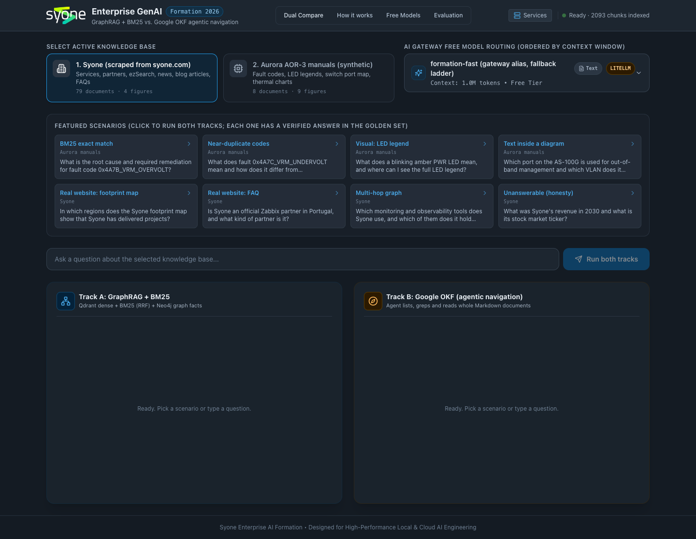
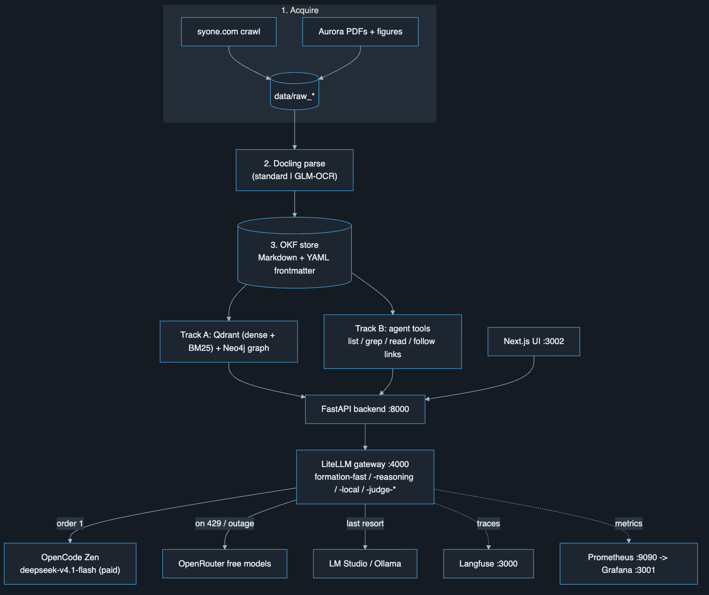

# Enterprise GenAI Formation: multimodal pipelines, dual retrieval, AI gateway, LLMOps

A hands-on training environment that builds one complete GenAI system and compares **two ways of giving an LLM your documents**:

* **Track A: GraphRAG + BM25**: chunk, embed, extract a knowledge graph; answer from dense + BM25 hybrid search plus graph facts.
* **Track B: Google OKF agent**: no index; a tool-calling agent *navigates* a folder of Markdown files (list, grep, read whole documents, follow links).

Around the two tracks: document parsing (Docling, optional GLM-OCR), an AI gateway with free-model routing (LiteLLM), tracing (Langfuse), metrics (Prometheus + Grafana), a golden evaluation set and a prompt-optimization loop.



## Where to start

| You are... | Read |
|---|---|
| **Trainee** running the code yourself | [PARTICIPANT_GUIDE.md](PARTICIPANT_GUIDE.md) |
| Setting up the AI gateway and its failover | [docs/AI_GATEWAY_FAILOVER.md](docs/AI_GATEWAY_FAILOVER.md) |
| Curious about the data | [DATA_PIPELINE_AND_SOURCES.md](DATA_PIPELINE_AND_SOURCES.md) |
| Reviewing the code | [docs/CODEBASE_REVIEW.md](docs/CODEBASE_REVIEW.md) |

## The two datasets

| | `syone_corp` | `hardware_manuals` |
|---|---|---|
| What | **Real** crawl of syone.com: 79 pages (services, partners, ezSearch, news, blog, FAQs) | **Fictional** Aurora Open Rack AOR-3 service library: 8 PDFs, 30 fault codes, 9 figures |
| Tests | Real-world text, FAQ, "what is Syone", honest *I don't know* | Exact codes (BM25), near-duplicates, tables, figures that carry facts, multi-hop relations |

Both are committed: a fresh clone works offline. Golden set: **34 verified questions** (`python scripts/validate_dataset.py`).

## Architecture



*Diagram source: `docs/diagrams/readme_1.mmd` (Mermaid). Re-render with `npx @mermaid-js/mermaid-cli -i docs/diagrams/readme_1.mmd -o docs/diagrams/readme_1.png -c docs/diagrams/mermaid.json -b "#141B23" -s 2`.*

## Quick start (about 15 minutes, 10 GB disk, Docker Desktop)

```bash
git clone <repo-url> && cd Enterprise_GenAI_Formation
cp .env.example .env                       # put a free OpenRouter key in it (see below)

uv venv --python 3.13 .venv && source .venv/bin/activate   # Python 3.11-3.14; 3.15 is too new for onnxruntime
uv pip install -r requirements.txt                         # without uv: python3.13 -m venv .venv, then pip install
python scripts/download_models.py --download   # ~600 MB: embeddings + Docling models

docker compose up --build -d               # 14 containers; first build takes a few minutes
python -m backend.ingestion.run_docling    # Stage 2: parse (about 40 s)
python -m backend.ingestion.run_okf        # Stage 3: compile the OKF store
python -m backend.graph_rag.indexer        # Stage 4: fill Qdrant + Neo4j
open http://localhost:13002
```

No API key? Everything still runs: answers fall back to **extractive mode** (the best retrieved passages, clearly labelled) and the retrieval evaluation needs no LLM at all. For generated answers, pick what fits (the gateway **fails over** between them, see below):

1. **OpenRouter** (recommended to start, free models, no credit card): `OPENROUTER_API_KEY`. Free accounts are capped at **20 requests/minute and 50/day** (1,000/day with $10 of credit); one question in the console uses about 5-9 requests.
2. **OpenCode Zen** (pay-as-you-go, what the speaker uses): `OPENCODE_API_KEY`, default model `deepseek-v4.1-flash`. The whole 34-question evaluation of both tracks cost about $0.28. *OpenCode's free models and the Go plan cannot be used through an API: see [docs/AI_GATEWAY_FAILOVER.md](docs/AI_GATEWAY_FAILOVER.md).*
3. **A virtual key from a speaker's shared gateway**: put `LITELLM_URL=http://<speaker-ip>:14000/v1` and `LITELLM_MASTER_KEY=<your key>` in `.env`. No provider account needed.
4. Other providers with a free API tier (**Groq**, **Google AI Studio**, **Mistral**): uncomment their block in `config/litellm_config.yaml`.
5. **LM Studio / Ollama** on your machine and the alias `formation-local`.

> **Sharing a gateway?** Change `LITELLM_MASTER_KEY` in `.env` first (`python3 -c "import secrets; print('sk-' + secrets.token_urlsafe(32))"`): it is the gateway's admin key. Trainees get restricted virtual keys instead (`python scripts/create_trainee_key.py`).

> **Why more than one provider?** Because limits are a fact of life: *this is exactly what an AI gateway is for.* Services call the alias `formation-fast`; LiteLLM tries provider A, and on a 429 or outage serves the request from provider B, then from another model family, then from a local model. The gateway also issues **virtual keys** (one model alias only, a budget, a rate limit, an expiry), so trainees never see a provider key. Setup, a live failover drill and the key tests: [docs/AI_GATEWAY_FAILOVER.md](docs/AI_GATEWAY_FAILOVER.md).

Data stages one by one (this is how the formation runs them): `python scripts/scrape_syone.py`, `python scripts/download_hardware_manuals.py`, then the commands above. Presenter shortcut: `./scripts/run_full_pipeline.sh`. Optional: parse the manuals with **GLM-OCR on your GPU** through LM Studio (`--engine glm-ocr --glm-backend lmstudio`, about 7 s per page versus about 6 minutes per page on the CPU).

## Services

The console's **Services** page (<http://localhost:13002/services>) lists every tool with its login, purpose and live status; **How it works** (<http://localhost:13002/how-it-works>) explains the console itself. The logins below are public demo defaults (one login everywhere: `syone` / `syone2026`). Every port is bound to `127.0.0.1`, so only your machine can reach them; change the logins before you open a port to a network.

| Service | URL | Login |
|---|---|---|
| **Formation UI** (dual comparison, how it works, free models, evaluation, services) | <http://localhost:13002> | none |
| FastAPI (OpenAPI docs) | <http://localhost:18000/docs> | none |
| Neo4j Browser | <http://localhost:17474> | `neo4j` / `syone2026` |
| Qdrant dashboard | <http://localhost:16333/dashboard> | none |
| Langfuse (traces, scores) | <http://localhost:13000> | `syone@syone.com` / `syone2026` |
| LiteLLM gateway (API) | <http://localhost:14000> | `Bearer sk-syone-formation-master-key` |
| LiteLLM admin UI (keys, spend, logs) | <http://localhost:14000/ui> | `syone` / `syone2026` |
| Grafana | <http://localhost:13001> | `syone` / `syone2026` |
| Prometheus | <http://localhost:19090> | none |

## Notebooks (`notebooks/`)

| # | Notebook | You learn |
|---|---|---|
| 1 | `01_docling_to_google_okf` | What parsing keeps and loses (tables, figures); Docling vs GLM-OCR; the OKF format |
| 2 | `02_graphrag_hybrid_neo4j_qdrant` | Chunking tables, entity extraction, dense vs BM25 vs hybrid with visible ranks, Cypher |
| 3 | `03_langchain_deep_agents_okf` | The four agent tools, scripted vs LLM navigation, `deepagents` |
| 4 | `04_litellm_langfuse_telemetry` | One gateway, aliases, **provider failover** (safe drill), **virtual keys**, Langfuse traces, Prometheus metrics |
| 5 | `05_opik_prompt_optimizer_lab` | Retrieval vs answer metrics on the golden set, an **LLM judge panel** (three model families), prompt optimization |

Regenerate them with `python scripts/generate_notebooks.py`; smoke-test all of them with `scripts/run_notebooks.sh`.

## Repository map

```
backend/            FastAPI app, ingestion (Docling, OKF), graph_rag (Qdrant, Neo4j, chunker), okf_agents (tools, agent loop), evaluation
frontend/           Next.js 15 UI (dual comparison, model explorer, evaluation)
config/             LiteLLM, Prometheus, Grafana provisioning
data/               raw datasets (committed) and generated stores (not committed)
scripts/            scrape_syone.py, validate_dataset.py, run_eval.py, download_models.py, dataset_builder/aurora/ (spec, figures, manuals)
notebooks/          the 5 formation notebooks
docs/               codebase review, screenshots, evaluation results
Documents/          slide deck, agenda and goals (Syone-internal: git-ignored, not published)
```

## Honest limits
This is a teaching system. Entity extraction is rule-based (an LLM extractor is the usual next step); evaluation is keyword based, with an optional panel of three LLM judges (they sometimes disagree with the keyword scores, and with each other: read those cases); GLM-OCR is slow on CPU; free models are rate limited and change every few weeks. Details and the full review: [docs/CODEBASE_REVIEW.md](docs/CODEBASE_REVIEW.md).

Designed for **Syone**. MIT License. Aurora Systems and the AOR-3 are fictional.
